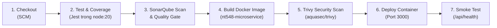

# Task 3: CI/CD Microservices với Jenkins, SonarQube & Container

- **Thành viên phụ trách:**
  - **Võ Duy Hiếu (Leader - 23520498):** Thiết kế hạ tầng CI/CD (`docker-compose.yml`, `Dockerfile.jenkins`), phát triển Microservice REST API Node.js & bộ Jest Unit Tests.
  - **Hoàng Lê Nhật Minh (23520926):** Xây dựng `Jenkinsfile` toàn trình, cấu hình SonarQube Quality Gate, tích hợp Trivy Container Security Gate, triển khai container & viết kịch bản Smoke Test.
- **Trạng thái:** ✅ **Hoàn thành 100%** (Đã hợp nhất vào nhánh `main`).

---

## 🛠️ 1. Môi trường Hạ tầng CI/CD Local

Cụm dịch vụ CI/CD được đóng gói qua `docker-compose.yml` và mạng Docker bridge `cicd-net`:
- **Jenkins Server (`jenkins-server`):** Cổng `8080` (Web UI) & `50000`. Được build tùy biến qua `Dockerfile.jenkins` (Java 21 `lts-jdk21`) tích hợp sẵn `docker-cli` và mount socket `//var/run/docker.sock`.
- **SonarQube Server (`sonarqube-server`):** Cổng `9000`. Phân tích tĩnh chất lượng mã nguồn, đo độ bao phủ kiểm thử (Code Coverage) và áp dụng tiêu chuẩn Quality Gate.
- **PostgreSQL 15 (`sonarqube-db`):** Cổng `5432`. CSDL quan hệ lưu trữ dữ liệu, cấu hình rules, tokens và lịch sử quét cho SonarQube.

### Lệnh khởi chạy:
```bash
# Di chuyển vào thư mục Task3
cd Lab2/Task3

# Khởi chạy cụm container (tự động build Dockerfile.jenkins nếu cần)
docker compose up -d --build

# Xem logs hoạt động
docker compose logs -f
```

### Lấy mật khẩu khởi tạo Jenkins:
```bash
docker exec -it jenkins-server cat /var/jenkins_home/secrets/initialAdminPassword
```

### Thông tin đăng nhập mặc định:
- **Jenkins:** `http://localhost:8080`
- **SonarQube:** `http://localhost:9000` (Tài khoản mặc định: `admin` / `admin`).

---

## 📦 2. Ứng dụng Microservice Mẫu (`app/`)

- **Công nghệ:** Node.js 20 (Express REST API).
- **Các API Endpoints:**
  - `GET /`: Trang chào mừng và thông tin phiên bản.
  - `GET /api/health`: Healthcheck endpoint phục vụ kiểm thử trạng thái hoạt động.
  - `GET /api/info`: Danh sách thông tin thành viên Nhóm 04.
- **Kiểm thử tự động:**
  - Viết bằng `Jest` và `Supertest` (`app/test/app.test.js`).
  - Đạt **100% Code Coverage** và tự động xuất báo cáo định dạng LCOV (`app/coverage/lcov.info`).
- **Đóng gói Docker:**
  - `Dockerfile` tối ưu theo mô hình **Multi-stage build** giảm dung lượng image.
  - Chạy dưới quyền non-root `USER node` nhằm nâng cao tính bảo mật khi Trivy quét lỗ hổng.

---

## 🚀 3. Pipeline CI/CD Toàn Trình (`Jenkinsfile`)

Quy trình tự động hóa được định nghĩa trong `Jenkinsfile` gồm 7 giai đoạn khép kín:



### Chi tiết các Stages:
1. **Checkout:** Kéo mã nguồn mới nhất từ kho chứa Git.
2. **Unit Test & Coverage:** Khởi chạy container `node:20-alpine` thực thi `npm test`, sinh báo cáo coverage LCOV.
3. **SonarQube Analysis & Quality Gate:** Chạy `sonarsource/sonar-scanner-cli` gửi dữ liệu phân tích sang SonarQube Server (`http://sonarqube:9000`) và đợi kết quả Quality Gate thông qua `waitForQualityGate()`.
4. **Build Image:** Thực thi `docker build` tạo image `nt548-microservice:${BUILD_NUMBER}`.
5. **Trivy Image Scan:** Sử dụng image `aquasec/trivy:latest` quét lỗ hổng bảo mật của image vừa build. Thiết lập tham số `TRIVY_FAIL_ON_CRITICAL` để chặn pipeline nếu phát hiện lỗ hổng mức `CRITICAL`.
6. **Deploy:** Dọn dẹp container cũ và khởi chạy container mới lắng nghe tại cổng `3000` trên host.
7. **Smoke Test:** Gửi HTTP request kiểm tra tính sẵn sàng của endpoint `http://localhost:3000/api/health`.

---

## 📂 4. Cấu trúc Thư mục Chi tiết

```text
Task3/
├── app/                             # Mã nguồn ứng dụng Microservice
│   ├── src/
│   │   ├── app.js                   # Khai báo Express API endpoints
│   │   └── server.js                # Khởi chạy server cổng 3000
│   ├── test/
│   │   └── app.test.js              # Bộ unit tests Jest & Supertest
│   ├── .dockerignore                # Loại bỏ file thừa khi build Docker
│   ├── Dockerfile                   # Multi-stage build Dockerfile (non-root)
│   ├── package.json                 # Cấu hình scripts & dependencies
│   └── package-lock.json            # Khóa phiên bản thư viện
├── docker-compose.yml               # Định nghĩa cụm dịch vụ Jenkins, SonarQube, PostgreSQL
├── Dockerfile.jenkins               # Image Jenkins JDK 21 tích hợp Docker CLI
├── Jenkinsfile                      # Kịch bản Pipeline CI/CD toàn trình
├── sonar-project.properties         # Cấu hình dự án & coverage cho SonarQube
└── README.md                        # Hướng dẫn chi tiết Task 3
```
